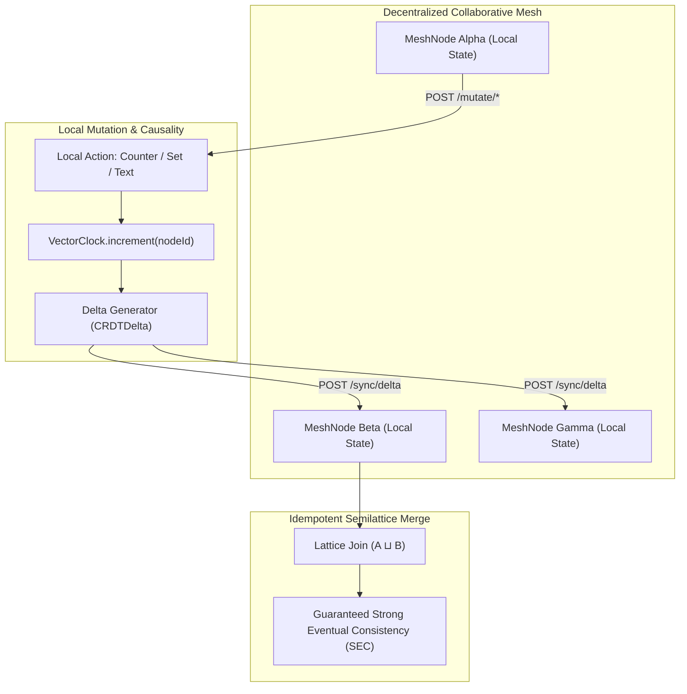

# crdt-collaborative-state-mesh

[](https://github.com/FelipeMadson/crdt-collaborative-state-mesh/actions)
[](LICENSE)
[](https://nodejs.org/)
[](package.json)
[](tests/)

> Decentralized Conflict-Free Replicated Data Type Mesh with Vector Clocks, RGA Text Sequencing, and Delta Synchronization, engineered in pure modern TypeScript with zero third-party dependencies.

Architected and maintained by **[Felipe Madison](https://github.com/FelipeMadson)** to enable multi-master edge collaboration, real-time rich-text synchronizations, and partition-tolerant distributed state machines without central coordination locks or cloud single-points-of-failure.

---

## 🚀 Key Architectural Highlights

1. **State-Based CRDT Semilattices $(S, \sqcup)$**:
   - **Monotonic Positive-Negative Counter (PN-Counter)**:
     - Maintains independent increment ($P$) and decrement ($N$) vectors.
     - Value: $\sum P - \sum N$.
     - Merge operator:
       $$(P_1 \sqcup P_2)(i) = \max(P_1(i), P_2(i)), \quad (N_1 \sqcup N_2)(i) = \max(N_1(i), N_2(i))$$
     - Provably commutative ($A \sqcup B = B \sqcup A$), associative ($(A \sqcup B) \sqcup C = A \sqcup (B \sqcup C)$), and idempotent ($A \sqcup A = A$).
   - **Last-Write-Wins Element Set (LWW-Element-Set)**:
     - Retains immutable add and remove sets with timestamps and tie-breaker node IDs.
     - Strong convergence under concurrent conflicting modifications.

2. **Replicated Growable Array (RGA) Text Sequencing**:
   - Preserves user editing intent and causal character positioning.
   - Nodes are anchored to preceding characters with deterministic conflict resolution on concurrent insertions:
     $$\text{Priority} = (\text{timestamp}_{\text{desc}}, \text{nodeId}_{\text{desc}})$$
   - Deletions are processed via tombstones, preventing character scrambling or missing anchor branches upon late delta delivery.

3. **Vector Clock Causality Tracking**:
   - Each node maintains a causal vector clock $V: \text{NodeId} \to \mathbb{N}$.
   - Detects causal precedence vs. concurrency:
     $$V_1 < V_2 \iff \forall k, V_1[k] \le V_2[k] \land \exists k, V_1[k] < V_2[k]$$
   - Seamlessly heals multi-node network splits and partitions with zero data loss.

4. **Autonomous HTTP REST & Prometheus Daemon**:
   - Zero external libraries; runs on Node.js standard `node:http`.
   - Endpoints:
     - `GET /health`: Node status, uptime, and mesh metrics.
     - `GET /metrics`: Native Prometheus metrics export.
     - `GET /state`: Live local CRDT state (counter, set elements, text, vector clock).
     - `POST /mutate/counter`: Local atomic counter increment/decrement.
     - `POST /mutate/set`: Local element addition or removal.
     - `POST /mutate/text`: Real-time character insertion or deletion.
     - `POST /sync/delta`: Ingests and reconciles remote peer deltas.
     - `GET /snapshot`: Full CRDT state snapshot for bootstrapping new peers.

---

## 🏛️ System Architecture



---

## 🛠️ Verification & Test Suite

Execute the complete automated test suite:

```bash
npm test
```

### Passing Verification Matrix

```text
✔ PNCounter - maintains commutative, associative and idempotent semilattice properties (0.9ms)
✔ LWWSet - resolves concurrent additions and deletions with Last-Write-Wins semantics (0.8ms)
✔ MeshNode - achieves Strong Eventual Consistency across 3 partitioned nodes (15.1ms)
✔ RGASequence - handles sequential text typing and deletions (1.4ms)
✔ RGASequence - resolves concurrent insertions at the same anchor without interleaving (0.5ms)
✔ CRDTServer - performs HTTP mutations, delta syncing and Prometheus metrics export (44.6ms)
✔ VectorClock - tracks causality, dominance and concurrency accurately (1.2ms)

tests 7 · pass 7 · fail 0 · duration_ms 271ms
```

---

## 💻 Quickstart & API Usage

```typescript
import { MeshNode, CRDTServer } from 'crdt-collaborative-state-mesh';

// 1. Initialize mesh nodes
const nodeA = new MeshNode('node-alpha');
const nodeB = new MeshNode('node-beta');

// 2. Perform concurrent mutations in isolation
const delta1 = nodeA.mutateCounter(10);
const { delta: deltaText } = nodeA.insertText('H', 'START');

const delta2 = nodeB.mutateCounter(25);
nodeB.addSetElement('admin-role');

// 3. Exchange deltas
nodeB.applyDelta(delta1);
nodeB.applyDelta(deltaText);
nodeA.applyDelta(delta2);

console.log(nodeA.getState().counter); // 35
console.log(nodeB.getState().counter); // 35 (Converged)

// 4. Start HTTP Server
const server = new CRDTServer(nodeA);
await server.listen(9092);
```

---

## 📄 License

MIT License. Copyright (c) 2026 Felipe Madison.
