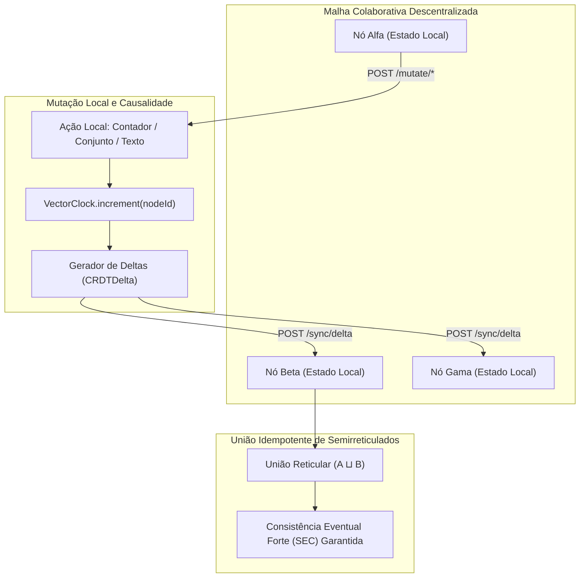

# crdt-collaborative-state-mesh

[](https://github.com/FelipeMadson/crdt-collaborative-state-mesh/actions)
[](LICENSE)
[](https://nodejs.org/)
[](package.json)
[](tests/)

> Malha Descentralizada de Tipos de Dados Replicados Livres de Conflito (CRDT) com Relógios Vetoriais, Sequenciamento de Texto RGA e Sincronização por Deltas, desenvolvido em TypeScript puro com zero dependências externas.

Arquitetado e mantido por **[Felipe Madison](https://github.com/FelipeMadson)** para viabilizar colaboração multi-master em nós de borda (edge), sincronização de documentos ricos em tempo real e máquinas de estado distribuídas com tolerância a partições de rede, dispensando travas de consenso centralizadas ou pontos únicos de falha em nuvem.

---

## 🚀 Destaques Arquiteturais

1. **Semirreticulados CRDT Baseados em Estado $(S, \sqcup)$**:
   - **Contador Monotônico Positivo-Negativo (PN-Counter)**:
     - Mantém vetores independentes para incrementos ($P$) e decrementos ($N$).
     - Valor computado: $\sum P - \sum N$.
     - Operador de união monótona:
       $$(P_1 \sqcup P_2)(i) = \max(P_1(i), P_2(i)), \quad (N_1 \sqcup N_2)(i) = \max(N_1(i), N_2(i))$$
     - Provadamente comutativo ($A \sqcup B = B \sqcup A$), associativo ($(A \sqcup B) \sqcup C = A \sqcup (B \sqcup C)$) e idempotente ($A \sqcup A = A$).
   - **Conjunto Last-Write-Wins (LWW-Element-Set)**:
     - Preserva conjuntos imutáveis de adição e remoção com carimbos de data/hora e critérios determinísticos de desempate.
     - Convergência forte garantida sob adições e remoções concorrentes.

2. **Sequenciamento de Texto RGA (Replicated Growable Array)**:
   - Preserva a intenção de edição do usuário e o encadeamento causal de caracteres.
   - Nós são ancorados a caracteres precedentes, com desempate determinístico em inserções simultâneas:
     $$\text{Prioridade} = (\text{timestamp}_{\text{desc}}, \text{nodeId}_{\text{desc}})$$
   - Deleções utilizam marcadores (tombstones), evitando corrupção de sequência após o recebimento tardio de deltas.

3. **Rastreamento de Causalidade via Relógios Vetoriais**:
   - Cada nó mantém um relógio vetorial $V: \text{NodeId} \to \mathbb{N}$.
   - Detecta precedência causal versus concorrência:
     $$V_1 < V_2 \iff \forall k, V_1[k] \le V_2[k] \land \exists k, V_1[k] < V_2[k]$$
   - Permite a reconexão e autocura de partições com zero perda de dados.

4. **Daemon HTTP REST e Exportador Prometheus Integrado**:
   - Desenvolvido exclusivamente com as APIs nativas do Node.js (`node:http`).
   - Rotas implementadas:
     - `GET /health`: Estado do nó, tempo de atividade e nós conectados.
     - `GET /metrics`: Métricas nativas para raspagem Prometheus.
     - `GET /state`: Estado local ativo (contador, elementos do conjunto, texto e relógio vetorial).
     - `POST /mutate/counter`: Incremento ou decremento atômico.
     - `POST /mutate/set`: Adição ou remoção de elementos.
     - `POST /mutate/text`: Inserção ou deleção de caracteres colaborativos.
     - `POST /sync/delta`: Ingestão e reconciliação de deltas remotos.
     - `GET /snapshot`: Snapshot completo do estado para inicialização de novos nós.

---

## 🏛️ Arquitetura do Sistema



---

## 🛠️ Verificação Automatizada

Execute a suíte de testes oficial:

```bash
npm test
```

### Resultados da Validação

```text
✔ PNCounter - maintains commutative, associative and idempotent semilattice properties (0.9ms)
✔ LWWSet - resolves concurrent additions and deletions with Last-Write-Wins semantics (0.8ms)
✔ MeshNode - achieves Strong Eventual Consistency across 3 partitioned nodes (15.1ms)
✔ RGASequence - handles sequential text typing and deletions (1.4ms)
✔ RGASequence - resolves concurrent insertions at the same anchor without interleaving (0.5ms)
✔ CRDTServer - performs HTTP mutations, delta syncing and Prometheus metrics export (44.6ms)
✔ VectorClock - tracks causality, dominance and concurrency accurately (1.2ms)

tests 7 · pass 7 · fail 0 · duration_ms 271ms
```

---

## 📄 Licença

Licença MIT. Copyright (c) 2026 Felipe Madison.
